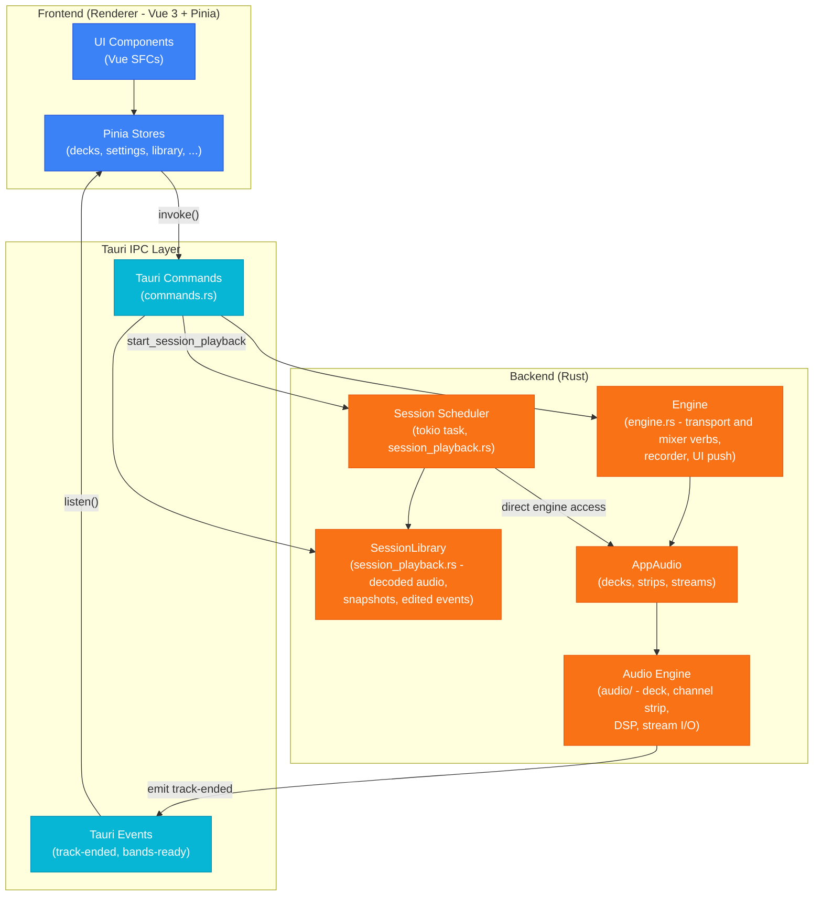
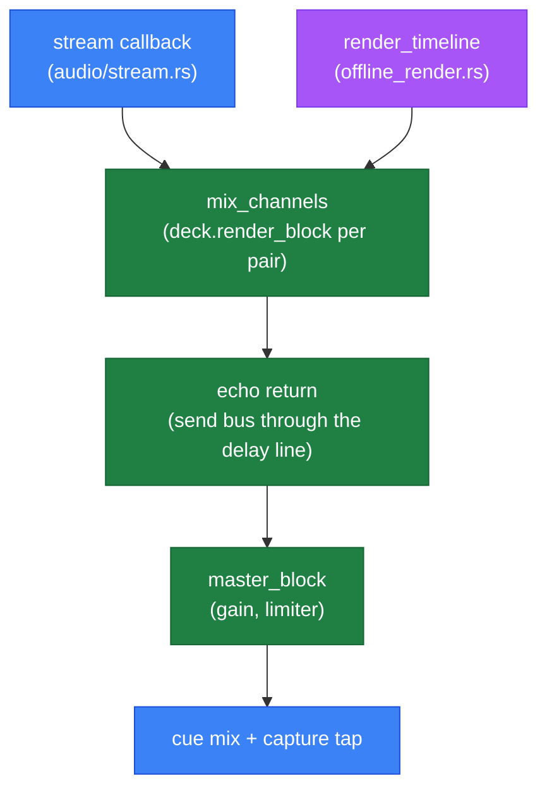
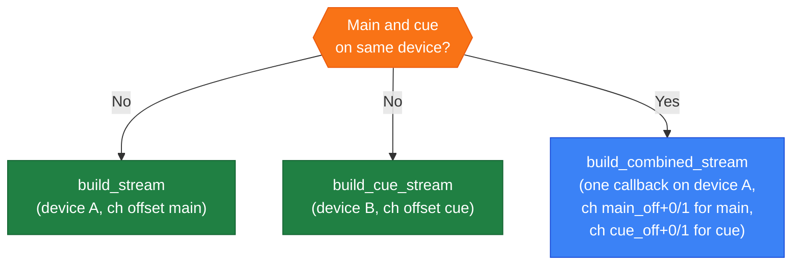
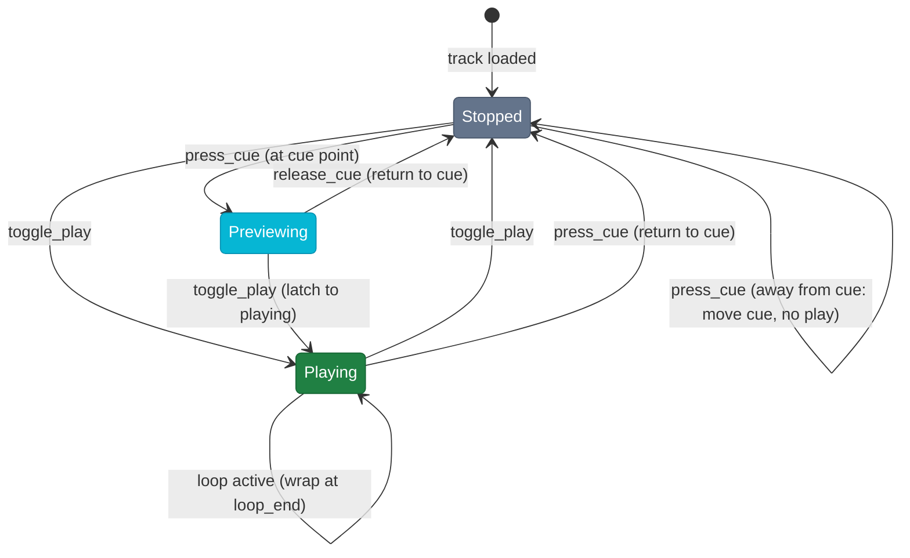
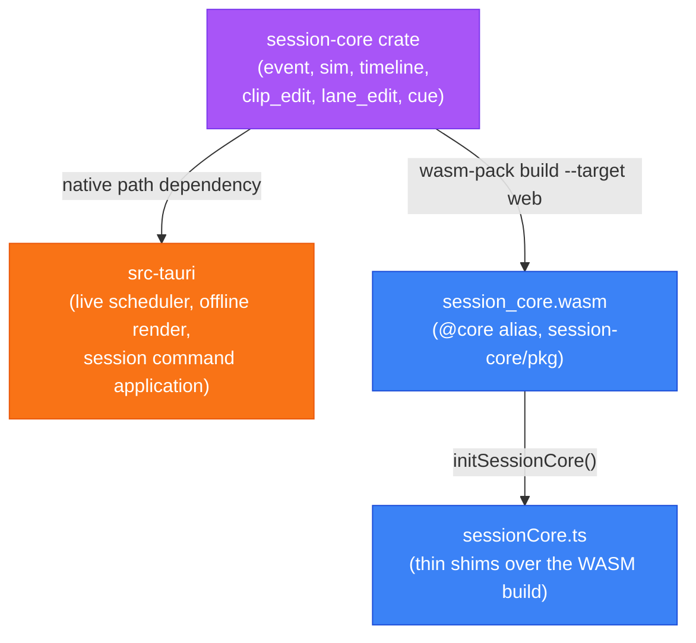

# Architecture

## Overall structure

Tauri manages three states independently, so a command receives only what it needs: `Engine` for
anything that moves a deck or the mixer, `SessionLibrary` for a loaded `.bms`, and `SurfaceControl`
for whether a control surface may drive the decks. `Engine` carries the audio handle, the session
recorder and the UI push together, because every write to the mixer also records itself and mirrors
back to the surface that did not move.

Every `#[tauri::command]` lives in `commands.rs`. Where the work belongs to another module the
command is a wrapper that calls into it, so `session_playback` and `midi` keep their internals
private.

## Calling a command

`tauriCommands.ts` is generated from the `#[tauri::command]` signatures (`yarn generate:commands`,
verified by `yarn check:commands`). Its `call` wrapper checks the command name, its arguments and
its return type against the Rust that will receive them, so it is the default.

The generator reads only primitives, `String`, `bool`, `Vec`, `Option` and `HashMap`. A command
returning a struct comes back as `unknown`, and those take `invoke<T>('name', args)` with `T` a
hand-written mirror: `DeckSyncPayload`, `TrackInfo`, `LoopOutResult` and the other transport
commands. Using `invoke` where the generator did type the return throws away the check.

## Engine contracts

- **The loop model is exactly three variables.** `cue_point` is both the CUE bookmark and the loop-in position. `main_pos` is the playhead and `loop_end` is loop-out. `loop_active` is independent of whether a region is defined, so reloop can re-enter one, and only loop-in or a new track clears the region.
- **Rust owns every transport decision.** Commands return a `DeckSyncPayload` the frontend applies verbatim. Quantization and all loop and position maths live in the command layer, never in `deck.rs` methods and never in JS.
- **CUE is routing, not transport.** `cue_pos` always advances while playing, and only the output is silenced when cue is off.
- **`DeckSim` and `DeckState` are two deliberate models** of the same commands, analytic and per-frame. They model time differently, so they are not merged behind a trait. The parity tests in `session_playback.rs` are the guard: the exhaustive `variant_catalog` match fails to compile until a new variant is classified.
- **`cue_mix` cannot work when main and cue are separate streams**, because the cue callback has no master signal there.

## Timing

- **The live scheduler waits on the master output-frame clock**, never on wall-clock sleep. The OS clock and the soundcard clock are different oscillators, so a one-time error becomes a permanent phase offset.
- **A command lands on the next callback.** An event that starts or repositions a playing deck is advanced by `overshoot * rate * nudge` to line up with decks already playing. A bare `play` on an already playing deck is not compensated, because that clicks.
- **A scrub starts every deck on one buffer.** Setup runs under brief per-deck locks with `is_playing = false`, then the flags flip under all the locks at once. A new scrub sets the old task's cancel flag and awaits its handle before touching the engine.
- **The recording and its start events share one anchor.** `arm_capture` picks the frame, the capture tap skips buffers that start before it, and `Recorder::start` stamps the same value. Every event carries the frame read under the lock that made the write, and nothing stamps from the free-running clock.
- **A logged `jog` carries the frame it was drained at**, and a replay puts its ticks straight into the filter at that frame. Nothing about the wheel depends on a block length. `offline_render.rs::live_parity` is the guard: it renders the live block path and the offline renderer over the same events and asserts byte equality across uneven block schedules.
- **A render plays a discarded lead-in before frame zero.** A snapshot restores targets, never filter state, so zeroed delay lines would pass every cut in full for the first milliseconds. The lead-in is a whole number of coefficient-refresh intervals, because the live callback advances that counter a whole buffer at a time.
- **Biquad coefficients are solved in f64 and narrowed once.** f32 coefficient maths lands one ulp apart between optimisation levels, and a resonant cascade grows that into audible differences over a sweep.

## Loading

Decode, playback and waveform analysis are three independent tracks. Decode gates playability and nothing else. The reduction runs on its own thread fed by the decoder, so the waveform paints while the file is still being read. A change that makes one of the three wait on another is wrong however green the suite is.

- **A track is decoded once**, by `load_track`, and every caller shares it through a per-path `OnceCell`.
- **One app-wide permit pool sized to the core count bounds every decode.** Bounding only some producers of a contended resource is worse than bounding none.
- **The analysis outlives the load.** `load_track` returns before the reduction ends, so two loads on one deck can overlap. Every load carries an id, and anything the analysis writes to a deck checks it first.
- **Waveform points travel as raw band levels.** The frontend divides by the track reference in `waveformColumns`, because a streaming reduction cannot know the reference until its last point.
- **Session playback is refused while loading, never queued**, and the gate opens once snapshots are built.
- **Nothing is gated on the file's rate matching the device's.** A shared device's nominal rate can change between runs, so each buffer carries the rate it was computed at and conversions happen where two meet.

## Audio signal chain (per deck)

```mermaid
graph LR
    classDef io fill:#64748b,stroke:#475569,color:#fff
    classDef deck fill:#3b82f6,stroke:#1d4ed8,color:#fff
    classDef strip fill:#208043,stroke:#166534,color:#fff
    classDef master fill:#d631b0,stroke:#a21caf,color:#fff
    classDef out fill:#f97316,stroke:#ea580c,color:#fff

    File["Audio File\n(.mp3, .flac, .wav)"]:::io
    Decode["Decode + Resample\n(io.rs)"]:::io
    Deck["Deck\n(playback position,\ncue/loop logic,\nspectral bands)"]:::deck
    ChannelStrip["ChannelStrip\n(manifest slots in order,\nthen the crossfader)"]:::strip
    Send["Send bus\n(tapped after\nthe crossfader)"]:::strip
    Echo["Master echo\n(returned into\nthe mix)"]:::master
    MasterMix["Master Mix\n(limiter, gain,\nmetering)"]:::master
    Outputs["Output Devices\n(main + cue)"]:::out

    File --> Decode
    Decode --> Deck
    Deck -- "main_tick()\ncue_tick()" --> ChannelStrip
    ChannelStrip -- "process_main()\nprocess_cue()" --> MasterMix
    ChannelStrip -- "sent()" --> Send
    Send --> Echo
    Echo --> MasterMix
    MasterMix --> Outputs
```

`Deck::render_block` is the single entry point the stream callbacks use to fill a buffer. Main and cue outputs are independently optional, so both routings below share one mixing loop.

## One block, two callers

A block of audio is produced in one place, whether it is heard now or rendered from a `.bms` later. `mix_channels` walks the same `(Deck, ChannelStrip)` pairs and `master_block` applies gain and the limiter over the result. The live callback adds the cue mix and the recording tap. The offline render adds neither.

Each strip adds its send to a send bus as it renders. The echo returns into the mix before `master_block`, so its tail is gained and limited with everything else rather than sitting outside the limiter.

The offline render works through the timeline in chunks of the buffer size the `.bms` recorded, because anything consumed once per callback rather than once per frame reads differently at another length.

## Mixer manifest

A `ChannelStrip` is not a fixed chain. `session_core::MixerManifest` describes it as an ordered list of slots, each naming a unit id that `audio/unit.rs` builds into an `AudioUnit`, plus a `cue_tap` slot and the master slots. `MIXER` in `audio/mod.rs` is the manifest the live engine starts on, and it can be swapped at runtime (below). The offline renderer builds whichever the `.bms` header names.

- **A slot is a position, not a unit.** `eq` is the second stage of the strip whatever fills it, so `classic-3band` and `classic-4band` share `eq/low` while different units fill it.
- **Every param carries its own range**, so nothing outside the manifest restates a min, max, step or default. `from_unit_interval` places a MIDI control on it and `clamp` bounds a `.bms` value.
- **`process_cue` taps before the `cue_tap` slot**, so the headphone feed is everything up to that point. The crossfader is applied after it, which is why a deck faded away is still audible in headphones.
- **A slot carries its voicing**, the frequencies and Q its unit is built with (`Voicing` in `param.rs`). Two EQs on the same dB scale sound different because of it, so it is hashed like the ranges. `make_unit` refuses a slot voiced for a different unit.
- **EQ bands are addressed by role.** `eq_bands` maps `EqBand::Low`, `LowMid`, `HighMid` and `High` to whichever params a mixer has, so a controller mapping written against the roles drives a three-band and a four-band EQ unchanged. The table is outside `content_hash`, because routing a control does not change what a recorded value means.
- **`content_hash` covers everything that changes what a `set_param` means.** `resolve_manifest` refuses a session whose mixer this build does not have or has since changed, and the shipped hashes are pinned by test because a `.bms` on disk carries them.

## Changing mixer at runtime

`AppAudio::set_mixer` rebuilds every strip on the new manifest without touching the streams. The streams hold `Arc<Mutex<ChannelStrip>>` and never see a manifest, so a strip built outside the lock and swapped inside it is the whole change.

A value crosses only when the receiving descriptor has the same min, max, default and step. Sharing an address is not enough. The engine applies that rule and returns every value the new strips hold, and the mixer store replaces its own values with them. The settings that apply to the whole mixer (`MasterSettings`: the fader curve and the filter resonance) are carried across with the strip.

A swap is refused while recording, because the `.bms` is stamped with the mixer it started on, and while a session plays, because the session was checked against the mixer playing it.

## Master effects

The echo and the filter resonance are master-scope params, addressed as `echo/time`, `echo/feedback`, `echo/lowCut`, `echo/return` and `filter/resonance`. `MasterEffects` in `audio/master.rs` is their one table of addresses, and `apply_master_effect` is the one path a change takes: it stores the value and pushes the resonance to every strip. The live engine keeps a `MasterEffects` behind the monitor, and each callback copies the echo settings out once per block. The offline render owns one outright and applies it as events arrive.

- **Each channel feeds the echo through its own send**, an amount plus an on switch, tapped after the crossfader. Pulling a fader down stops feeding the echo and leaves the tail ringing.
- **Recording stamps where every master effect stood** at `recording_start`, and session snapshots carry them, so a render or a scrub that starts mid-session hears the settings that were live. A render's discarded lead-in also lasts as long as the echo takes to decay when a deck is sending, capped at 20 s and at the audio each deck has to replay.
- **`AudioUnit` has one hook for settings that apply to the whole mixer**, `apply_master(&MasterSettings)`. The fader reads the curve and the sweep filter reads the resonance. A new master setting adds a field, not a trait method.

## Engine to UI

Turn a knob on the controller and the on-screen knob has to move with it. `engine_push.rs` does that, and it has to survive a physical fader sweep, which can produce hundreds of MIDI messages a second.

It never queues values. Each change records only _which_ control moved: deck A's EQ low, the crossfader, deck B's transport. A background thread wakes every 16 ms, reads the current value of each control that moved, and emits one batch (`engine-params`, `engine-transport`, `engine-rate`, `engine-assign`).

Two consequences fall out of storing addresses instead of values:

- **A sweep costs one message per flush, not one per MIDI tick.** Three hundred writes to the same fader in one window are one entry in the set.
- **A push can never carry a stale value.** The value is read at flush time, so it is whatever the engine holds right then, not whatever it held when the write happened.

`ParamOrigin` decides what gets recorded at all. A `Ui` write is skipped: the UI made that change and already shows it, so echoing it back would drag the control out from under the user's pointer mid-drag. Only `Midi` writes are pushed.

## Stream routing

## CUE state machine

## Shared session-core crate (Rust + WASM)

The session event model, replay simulation, timeline (clips/lanes), edit operations (clip move/trim/delete, lane automation and resets, filter-region edits), and CUE-sheet track-point derivation live in `session-core`, a Rust crate shared by the native engine and the frontend. It is built twice from the same source: as a native path-dependency of `src-tauri`, and via `wasm-pack build --target web` into `session-core/pkg` (gitignored, built by `yarn build:wasm`), loaded by the frontend through the `@core` alias. This keeps TypeScript from reimplementing the same simulation/edit logic as the Rust engine, where the two could silently drift out of sync.

`session_apply.rs::apply_deck_command` is the single implementation of `SessionCommand` application against the real `Deck`/`ChannelStrip`, used by both the live scheduler and the offline renderer (parameterized over sample loading and live-only start-latency compensation). `session-core`'s own `DeckSim`/`StripSim` (used for scrub simulation and by the WASM build) remain a separate, audio-free implementation of the same command semantics, since the crate has no audio buffer types.

## Session timeline rendering

The timeline is retained-mode over a plain 2D canvas. The scene is a flat list of `SceneItem`s (`utils/timelineEngine.ts`). An item knows its own bounds, draws itself clipped to them, and hit-tests itself. No item holds gesture state.

Two orderings run over that list, and they are deliberately not the same one:

- **Draw order** is list order. The scene builder composes it, earlier items paint under later ones.
- **Hit precedence** is a separate table in `utils/timelineHits.ts`, keyed by `target:part` so a clip's trim edge can outrank a separator while its body does not. When several items claim a point, the highest-ranked claimer wins, ties broken by draw order.

`composables/useTimelineGestures.ts` is the interaction layer. On pointer-down it hit-tests the scene, picks a gesture from the hit plus modifiers, and drives the drag, emitting semantic intents that the controller reacts to. Gesture visuals in progress (the draw line, a clip ghost, the filter preview) are pushed back as overlay `SceneItem`s, so the renderer draws them like anything else.

## Performer state broadcast

`src-tauri/src/broadcast.rs` publishes each live deck's beat state (bpm, beat offset, position, rate, nudge, `current_beat`) every 50 ms for an external app to phase-sync to: an atomically-replaced `state.json` in the app data dir on all platforms, plus a Unix domain socket (`beatmatcher.sock`, newline-delimited JSON) on unix. Best-effort: a slow socket reader drops frames, not the connection, and a sink setup failure disables broadcasting instead of aborting startup. The beat math is `session_core::current_beat`, the same function the phase ring uses via WASM.

## MIDI control

`src-tauri/src/midi/` owns the MIDI connection on its own thread and reaches the rest of the app through a single dispatch closure installed with `set_dispatch`. Nothing else crosses that boundary, so mapped input cannot reach device or buffer configuration, which rebuild the streams and stay on the main thread.

Decoding a message and reading a mapping file are separate modules, each importing only the addressing vocabulary it uses. That vocabulary, the byte constants and `Source`/`Key`/`Resolution`/`Half`, is its own module because both need it. The connection, the device registry and dispatch into the engine stay in `mod.rs`.

The mapping file format and how to contribute one are in [CONTRIBUTING.md](CONTRIBUTING.md#controller-mappings).

## Further reading

- [App modes and transitions](docs/app-modes.md)
- [Session playback and editing](docs/session-playback.md)
- [.bms file format](docs/bms-format.md)
